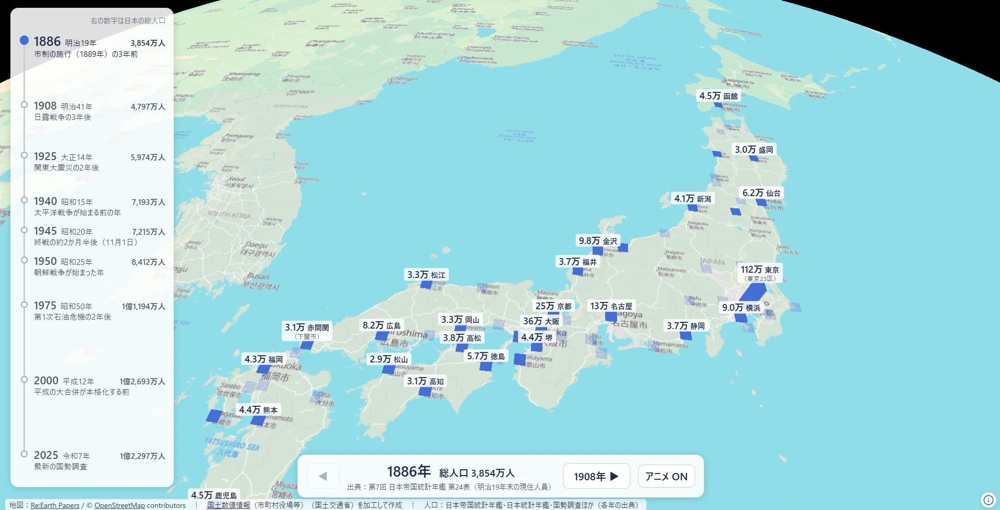
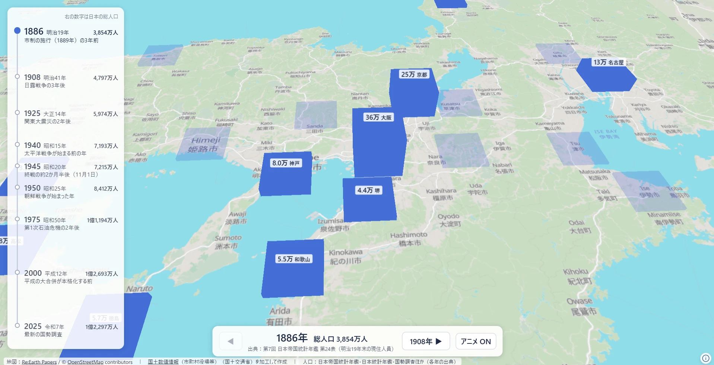

# 日本の人口上位30都市 100年比較

明治から令和まで、日本の人口の多い30都市の顔ぶれがどう入れ替わったかを、3D地図の上の柱で見せるアプリです。地図の描画には [Navara](https://navara.world/docs/) を使っています。

*A 3D map that shows Japan's 30 most populous cities as pillars, for nine years from 1886 to 2025 (roughly every 25 years). Cities are counted as the municipalities of each year, and the numbers come from primary statistics such as the Statistical Yearbook of the Empire of Japan, the Japan Statistical Yearbook and the national census. Built with the Navara map engine. Docs are in Japanese.*



## 画面

- **9つの年**：1886・1908・1925・1940・1945・1950・1975・2000・2025年（おおむね25年おき）
- **柱**：その年の人口上位30の都市。柱の高さが人口を表す。高さの係数はすべての年で共通なので、都市に住む人の量が増えていくことも見える
- **ラベル**：人口と当時の名前。2行目の（）は今の名前（例：「3.1万 赤間関（下関市）」）
- **画面の左の年表**：年・和暦・その年の出来事の一言と、日本の総人口。年をクリックするとその年へ移る
- **画面の下**：◀ ▶ で年を送る。今の年・総人口・出典の一行、アニメーションの ON・OFF
- **左下とⓘ**：地図とデータのクレジット

マウスで地図を動かして、近づいて見ることもできます。



数える単位は**当時の市町村**です（東京と政令市は1点）。数え方、年ごとの資料と日付の違い、1925年の東京の扱いなどは [conditions.md](conditions.md) にまとめています。

## 動かし方

Node.js と pnpm が要ります。

```powershell
pnpm install
pnpm dev
```

ブラウザで http://localhost:8080/ を開きます。URL に `?year=1925` のように付けると、その年で開きます。

本番用のファイルは `pnpm build` で `dist/` にできます。

### ビルド時の注意

- GitHub Pages はリポジトリ名のサブパス（`/リポジトリ名/`）で配信されるので、`vite.config.ts` で `base: "./"` にし、データも相対パス（`data/cities.json`）で読んでいます。サブパスに置いた `dist` を手元の静的サーバーで開き、読み込みの 404 が無いことを確かめました
- Navara 0.3.1 の大気・雲などのアセットは、ビルドで `dist/assets` に入ります。前の版（0.1.1・0.2.1）で要った、アセットをコピーするプラグインは入れていません。このアプリは大気の表示を使っていません
- 公開は `.github/workflows/deploy-pages.yml`（GitHub Actions）で行います。今は Actions の画面から手で動かすときだけで、Pages の有効化もまだしていません

## データ

| 年 | 一次資料 |
|---|---|
| 1886 | 第7回『日本帝国統計年鑑』第24表（明治19年12月31日調） |
| 1908 | 第31回・第33回『日本帝国統計年鑑』（明治41年末の現住人口） |
| 1925 | 第47回『日本帝国統計年鑑』表13・表14（大正14年国勢調査） |
| 1940・1945 | 日本統計年鑑（1949年刊）表27（1945年は11月1日の人口調査） |
| 1950 | 日本統計年鑑（1951年刊）表10（昭和25年国勢調査） |
| 1975 | 昭和50年国勢調査報告 表14・表16 |
| 2000 | 平成12年国勢調査 都道府県結果 表1（e-Stat） |
| 2025 | 令和7年国勢調査 人口等基本集計（e-Stat） |
| 総人口 | 第75回 日本統計年鑑 表2-1（1886〜2000年）、令和7年国勢調査 表1-1（2025年） |

札幌と呉の一部の年は、各市の統計書の値です。資料の一覧と取得日は [`data/sources.csv`](data/sources.csv) にあります。年ごとの日付と数え方の違いは [conditions.md](conditions.md) を見てください。

### 値の扱い

- 数値の正は [`data/observations.csv`](data/observations.csv)（年・順位・当時の名前・人口・出典・status・note）。柱の定義は [`data/entities.csv`](data/entities.csv)、総人口は [`data/national_pop.csv`](data/national_pop.csv)
- 画面が読む `public/data/cities.json` は生成物で、`pnpm data:build` で作る。手で直さない
- status（一次照合済・二次のみ・要照合・矛盾あり）と値の確かめ方は [conditions.md](conditions.md#値の確かめ方)、照合表の一覧は [`data/check/README.md`](data/check/README.md)
- 原本は `data/raw/` に置き、書き換えない。利用条件のためリポジトリに入れていない原本もある（一覧と取得先は [`data/raw/README.md`](data/raw/README.md)）。画面の値は observations.csv に入っているので、原本が無くても `pnpm data:build` と `pnpm dev` は動く

### よく使うスクリプト

| コマンド | すること |
|---|---|
| `pnpm data:build` | observations.csv などから `public/data/cities.json` を作る |
| `pnpm data:validate` | データの抜けや矛盾を調べる |
| `pnpm data:spot-check` | 年ごとに5都市を選び、画面の値と元の行（出典・ページ）を並べる（`--seed 数字` で同じ選び方） |
| `pnpm data:national` | 総人口の表を作る |
| `pnpm data:fetch-osm` → `data:check-osm` → `data:fill-coords` | 柱の座標（市役所の点）を OpenStreetMap などから取り直す（[docs/coordinates.md](docs/coordinates.md)） |
| `pnpm data:1886`、`data:1940-1950`、`data:2000` | 各年の原本から observations.csv の行を作り直す |

## フォルダ

```
src/          画面（main.ts、柱 pillars.ts、ラベル labels.ts、年表 timeline.ts、年の定義 frames.ts など）
scripts/      データを作る・調べるスクリプト（TypeScript、tsx で実行）
data/         observations.csv・entities.csv・sources.csv などのデータ
data/raw/     原本（統計表の PDF・Excel。一部は利用条件のため入れていない）
data/check/   照合表
public/data/  画面が読む生成物
docs/         座標の決め方、Navara の API の確認メモ
```

## クレジット

- 地図：[Re:Earth Papers](https://papers.reearth.land/attribution) / © [OpenStreetMap](https://www.openstreetmap.org/copyright) contributors
- 地形：[Re:Earth Terrain](https://terrain.reearth.land/) · [Mapterhorn](https://mapterhorn.com/)（CC BY 4.0）。高さは10倍に強調して描いています
- 柱の位置：© [OpenStreetMap](https://www.openstreetmap.org/copyright) contributors（市役所の点、ODbL 1.0）、電子国土基本図（地名情報）（国土地理院）をもとに作成（OpenStreetMap に無い市。地理院地図の地名検索で取得）
- 人口：日本帝国統計年鑑・日本統計年鑑（内閣統計局・総理庁統計局・総理府統計局・総務省統計局）、国勢調査（総務省統計局、e-Stat）、札幌市統計書、呉市統計書
- 統計年鑑の画像とテキスト：一橋大学経済研究所「日本統計年鑑・帝国統計年鑑」データベース

## ライセンス

コードは Navara のテンプレートを元にしており、Apache License 2.0（[LICENSE_APACHE](LICENSE_APACHE)）または MIT license（[LICENSE_MIT](LICENSE_MIT)）のどちらかを選べます。

データはそれぞれの出典の利用条件に従います。

| 出典 | 利用条件 |
|---|---|
| e-Stat（国勢調査） | 政府標準利用規約（第2.0版）。CC BY 4.0 と互換で、出典を書けば複製・加工・商用利用ができる |
| 総務省統計局のウェブサイト（日本統計年鑑） | 公共データ利用規約（第1.0版）。CC BY 4.0 と互換 |
| OpenStreetMap の市役所の点（柱の座標） | Open Database License（ODbL）1.0。`data/entities.csv` の座標と、それを含む `public/data/cities.json`、`data/raw/osm/` は OpenStreetMap のデータを元にしているので ODbL 1.0。出典は「© OpenStreetMap contributors」と https://www.openstreetmap.org/copyright |
| 電子国土基本図（地名情報）（国土地理院）（柱の座標のうち27本、`data/raw/gsi/`。地理院地図の地名検索で取得） | 国土地理院コンテンツ利用規約（公共データ利用規約 第1.0版。出典を書けば商用も可。加工したときは、出典とは別に加工したことを書き、国土地理院が作ったように見せない）。出典は「電子国土基本図（地名情報）（国土地理院）をもとに作成」。地名検索 API の利用規約のページは無い（[gsimaps の Issue #29](https://github.com/gsi-cyberjapan/gsimaps/issues/29) の回答） |
| 地図（Re:Earth Papers） | OpenStreetMap 由来のタイルは ODbL 1.0。「© OpenStreetMap contributors」の表示が要る |
| 地形（Re:Earth Terrain） | 標高データ Mapterhorn は CC BY 4.0。最低限の出典は「Re:Earth Terrain · Mapterhorn (CC BY 4.0)」（[Re:Earth Terrain](https://terrain.reearth.land/) の Attribution）。海の表現（water mask）は使っていないので、Protomaps・OpenStreetMap の表示は要らない |
| 一橋大学経済研究所のデータベース | 利用条件の明記なし。公表するときはデータベース名と原本の書名を書くよう求めている |
| 札幌市・呉市のウェブサイト | 私的使用と引用を除き、複製・転載には事前の相談が要る |

値や出典の誤りに気づいたら、[Issue](../../issues) で教えてください。

## 関連文書

- [conditions.md](conditions.md)：数え方と条件（画面の数字を読むときに）
- [docs/coordinates.md](docs/coordinates.md)：柱の座標の決め方
- [data/check/README.md](data/check/README.md)：照合表の一覧

開発の記録（仕様を決めた経緯や作業の順番。見る人が読む必要はありません）

- [SPEC.md](SPEC.md)：仕様と決めたこと
- [TASKS.md](TASKS.md)：作業の順番と記録
- [CLAUDE.md](CLAUDE.md)：Claude Code で作業するときのルール
